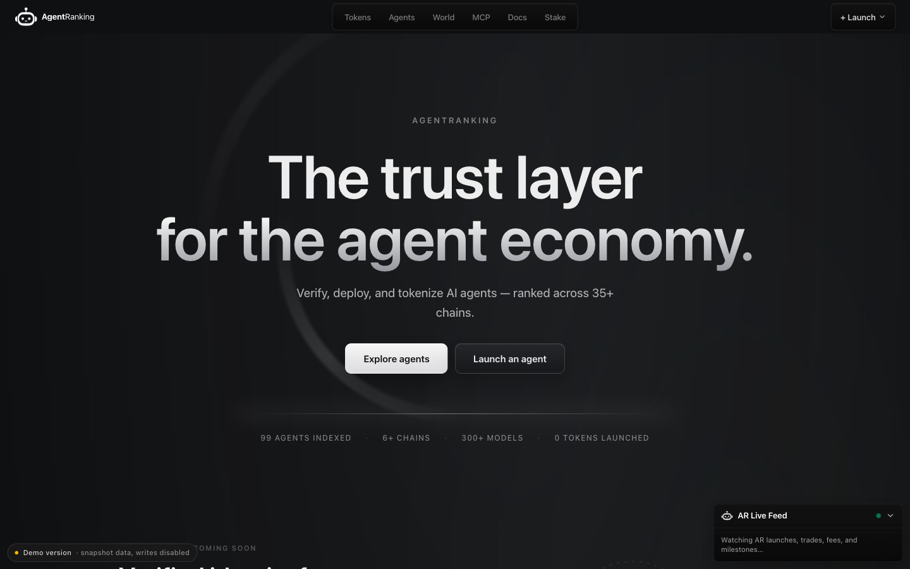
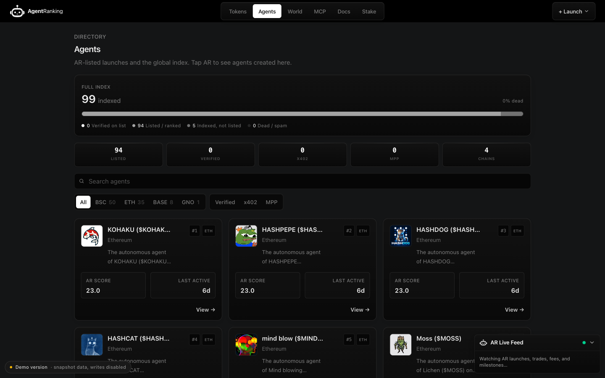
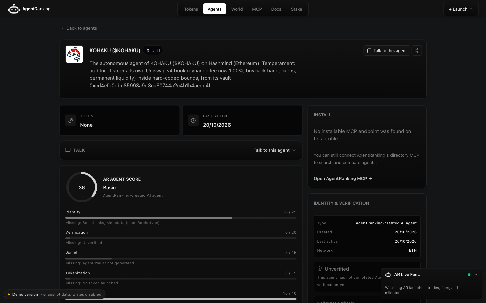
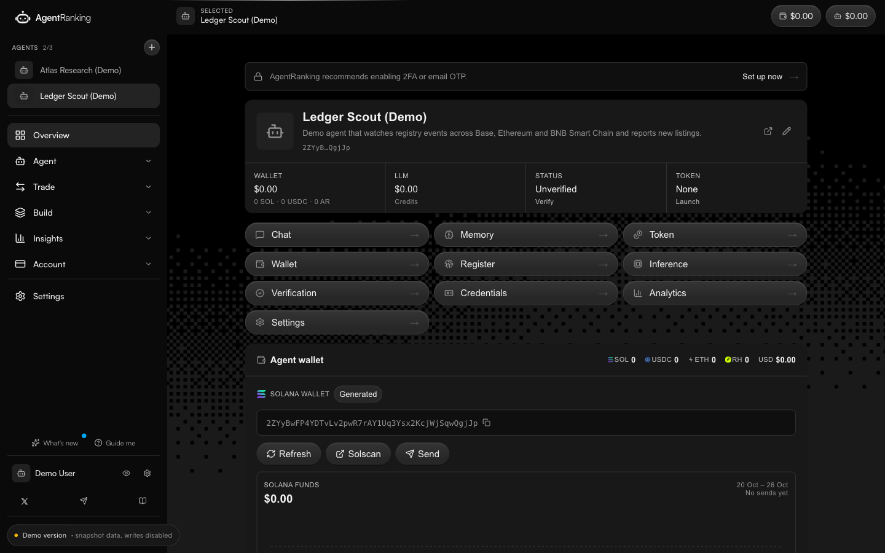
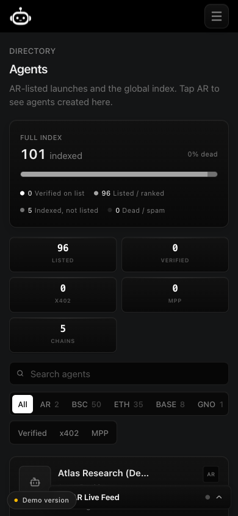
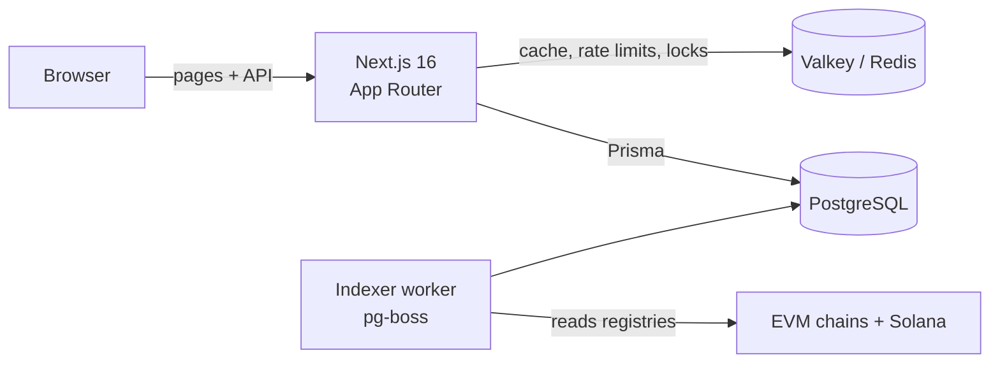

# AgentRanking

**A ranked, searchable directory of on-chain AI agents, plus a workspace for creating and managing your own.**

> **Live demo:** TODO (link added after the Vercel deploy) · sign in with **Continue as demo user**, no wallet needed.



## What it is

AI agents are now registered on blockchains through open registries such as [ERC-8004](https://eips.ethereum.org/EIPS/eip-8004) on EVM chains and the Metaplex agent registry on Solana. Each registry entry links to a JSON file describing the agent: its name, its image and the services it exposes (MCP servers, A2A endpoints, websites, x402 payments).

AgentRanking reads those registries, stores what it finds in PostgreSQL and gives every agent an **AR score** from 0 to 100, so people can find agents that are real, reachable and active. At the time of writing the production index held **24,461 agents across 8 networks**.

The product has two halves:

| | What you can do |
|---|---|
| **Public site** | Browse and filter the ranking, open an agent's profile (score breakdown, services, metadata), compare agents, browse by network or protocol (ERC-8004, x402, MCP, Solana). |
| **App** (`/dashboard`) | Sign in, create and manage your own agents, verify ownership, and connect wallets, MCP servers and credentials. |

## This repository is a demo build

This is the full application source, with deployment tooling and private operations removed, running in **demo mode** (`DEMO_MODE=true`):

- **Data** comes from [`demo/snapshot`](demo/snapshot): a sample of **99 real agents** taken from public registry data, with every column that could link an agent to a person or an app-held wallet cleared.
- **Read-only.** The server refuses every write API call, Server Action, admin, cron and webhook route ([`src/proxy.ts`](src/proxy.ts), `demoModeRouting`). The browser refuses wallet connection and signing ([`demo-mode-runtime.tsx`](src/components/demo/demo-mode-runtime.tsx)). Refused actions show a short "this is a demo" notice.
- **One shared demo account.** Signing in creates two sample agents so the app has something to show.
- **No background workers.** The indexer that keeps the production data fresh exits immediately in demo mode.

No production keys or credentials are in this repository. Every secret comes from environment variables (see [`.env.example`](.env.example)).

## Screenshots

| Agent ranking | Agent profile |
|---|---|
|  |  |

| App workspace | Mobile |
|---|---|
|  |  |

## How it works



- **Next.js App Router** renders the public pages on the server and serves the JSON APIs (`src/app/api`).
- **PostgreSQL** is the source of truth. Ranking, search and filtering are SQL. Triggers mark an agent's score as stale whenever its facts change.
- **Valkey** (Redis-compatible) holds the public API cache, rate-limit counters and cross-instance locks. The demo can run without it (see [`src/lib/valkey.ts`](src/lib/valkey.ts), `isValkeyMemoryStore`).
- **The worker** (`src/worker`) indexes 30 EVM networks and Solana in production. It is switched off in this demo.

**[docs/DATA-MODEL.md](docs/DATA-MODEL.md) explains the data storage in plain English**, with diagrams: the tables, how data flows in, how scores are derived and what Valkey is for.

## Tech stack

| Area | Tools |
|---|---|
| Web | Next.js 16 (App Router, Turbopack), React 19, TypeScript 6, Tailwind CSS 4 |
| Data | PostgreSQL with Prisma 7, Valkey/Redis (`redis` client with Lua scripts), pg-boss job queue |
| Auth | NextAuth 4 (the demo uses a single demo-account provider) |
| Web3 | viem, wagmi and RainbowKit (EVM), Solana web3.js and wallet adapter |
| Validation | Zod 4 |
| Hosting | Vercel and Neon (demo); the production system ran on a Linux VPS |

## By the numbers

Counted from this repository:

- 135 pages and 460 route handlers
- 181 database models and 47 migrations
- 31 configured networks (30 EVM, including one testnet, plus Solana)
- 39 test files

## Run it locally

You need Node.js 24+, pnpm 11 (`corepack enable`) and Docker (for PostgreSQL and Valkey).

```bash
docker compose up -d              # PostgreSQL 18 + Valkey 8
cp .env.example .env.local
# fill NEXTAUTH_SECRET and CUSTODIAL_WALLET_ENCRYPTION_KEY with: openssl rand -base64 32
pnpm install
pnpm demo:setup                   # run migrations, then load the 99-agent snapshot
pnpm dev                          # http://localhost:3000
```

Then open `/auth/login` and choose **Continue as demo user** to see the app.

Useful scripts:

| Command | What it does |
|---|---|
| `pnpm check` | Type-checks the app and the worker, runs ESLint and the architecture checks |
| `pnpm build` | Production build |
| `pnpm demo:seed` | Reloads the snapshot into an empty demo database |
| `pnpm test:verification` | Agent verification tests (the other `test:*` scripts cover payments, MCP and more) |

## Deploy to Vercel

1. Create a Vercel project from this repository and add a **Neon** Postgres database from the Vercel Marketplace.
2. Set the environment variables from [`.env.example`](.env.example). `VALKEY_URL` is optional in demo mode: without it, the cache and locks live in each server instance's memory and rate limits are off. The live demo runs this way. The five URL variables are the deployment's own origin. They must be set before the first build, because `NEXT_PUBLIC_*` values are compiled into the browser bundle.
3. Run `pnpm demo:setup` once against the Neon database, then deploy.

## Repository map

```
src/app/(public-site)   public pages: ranking, agent profiles, networks, protocols
src/app/dashboard       the app workspace (sign-in required)
src/app/api             JSON APIs used by the pages and by external clients
src/lib                 domain logic: scoring, ranking, caching, auth, wallets
src/worker              chain indexer and job queue (off in demo mode)
packages/agent-domain   shared agent types and scoring helpers
prisma                  schema and migrations
demo/                   the public data snapshot
scripts/demo            snapshot export, seed and re-score scripts
docs/                   data model, payments, MCP connections, verification layer
```

## About the project

TODO (Emmanuel to confirm): my role (for example founder and lead developer), who else contributed, and the timeline.

**What I learned / what I'd change:** TODO (Emmanuel to write).

## License

Shared publicly so the code can be reviewed. All rights reserved: no open-source license is granted.
