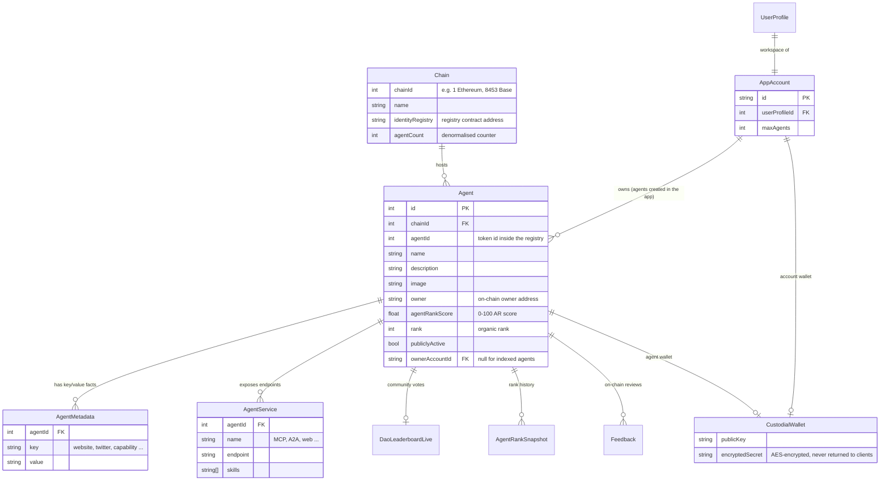
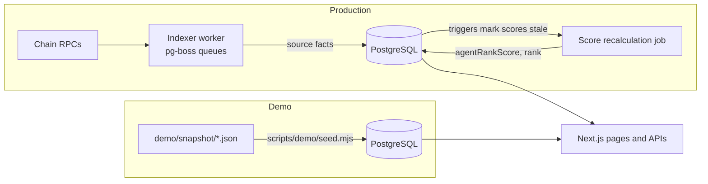

# How AgentRanking stores data

AgentRanking keeps two kinds of state:

| Store | What lives there | Why |
|---|---|---|
| **PostgreSQL** (via Prisma) | Everything durable: agents indexed from chains, their metadata and endpoints, scores and ranks, user accounts, the agents users create, wallets, launches, chat and memory. | One relational source of truth. Ranking, search and filters run as SQL. |
| **Valkey** (Redis-compatible) | Short-lived state: cached public API responses, rate-limit counters, locks between server instances. | Fast, shared between serverless instances, safe to lose. |

The schema is [`prisma/schema.prisma`](../prisma/schema.prisma) (181 models). That number is large because the full product also covers payments, cards, trading and MCP integrations. The core is small, and it's described below.

## The core: agents and where they come from

An **agent** is an AI agent registered on a blockchain registry, such as ERC-8004 on EVM chains or the Solana and Metaplex agent registries. The registry entry points at a JSON "registration file" that describes the agent: name, image, description, and the services it exposes (MCP, A2A, web, x402 payments). AgentRanking reads those registries, stores what it finds and scores every agent.

**Reading the diagram:**

- **`Chain`**: one row per supported network, holding the registry contract addresses and indexing progress.
- **`Agent`**: one row per registered agent. `(chainId, agentId)` is its on-chain identity. Score columns such as `agentRankScore`, `rank` and the `score*` dimensions are *derived*: they're recomputed from the source facts and never typed in by hand.
- **`AgentMetadata`** and **`AgentService`**: the registration file, flattened into rows so it can be searched and filtered with SQL.
- **`AppAccount`** and **`UserProfile`**: a signed-in person and their workspace. Agents created inside AgentRanking have `ownerAccountId` set. Agents indexed from chains don't.
- **`CustodialWallet`**: wallets the app holds for agents. Only the public key is ever shown; the secret is stored encrypted with `CUSTODIAL_WALLET_ENCRYPTION_KEY`.

## How data gets in

In **production**, a background worker ([`src/worker`](../src/worker)) scans the registries on 30 EVM networks and Solana. It stores raw facts, and database triggers then mark each changed agent's score as stale (`score_state_version`). A score job recomputes it ([`src/worker/indexer/sync/score-recalculation.ts`](../src/worker/indexer/sync/score-recalculation.ts)), and a rank pass orders everyone ([`src/lib/compute-ranks-queries.ts`](../src/lib/compute-ranks-queries.ts)). Paid promotion is excluded from organic rank.

The **demo** skips all of that. [`demo/snapshot`](../demo/snapshot) holds a curated sample of real, public registry data: 99 agents on Ethereum, BNB Smart Chain, Base and Gnosis, with their metadata, services and vote counters, and with scores already computed by the same code. [`scripts/demo/seed.mjs`](../scripts/demo/seed.mjs) loads it into an empty database in one transaction. Every column that could link an agent to a person or a wallet the app controls is cleared at export time ([`scripts/demo/snapshot-schema.mjs`](../scripts/demo/snapshot-schema.mjs)).

## What Valkey is used for

| Use | Where |
|---|---|
| **Response cache for public APIs and pages**, versioned by a "generation" number per data domain. When agents change, the generation moves forward and old entries stop being read, so nothing has to be deleted one key at a time. | [`src/lib/public-api-cache.ts`](../src/lib/public-api-cache.ts) |
| **Single-flight leases**, so that when the cache is cold only one server instance rebuilds an entry while the others wait for it. | [`src/lib/valkey.ts`](../src/lib/valkey.ts) (`withValkeyLease`) |
| **Sliding-window rate limits** on the public API. | [`src/lib/public-api-rate-limit.ts`](../src/lib/public-api-rate-limit.ts) |

All of this is written as small Lua scripts, so each check-and-update is atomic in Valkey.

## Where to start reading

| If you want to see… | Open |
|---|---|
| How a page loads its data | [`src/lib/ranking/public-ranking.server.ts`](../src/lib/ranking/public-ranking.server.ts) (the agent directory) |
| How an agent is scored | [`src/lib/agent-scoring-layers.ts`](../src/lib/agent-scoring-layers.ts) and [`packages/agent-domain`](../packages/agent-domain) |
| How the indexer reads a chain | [`src/worker/indexer/sync/identity-events.ts`](../src/worker/indexer/sync/identity-events.ts) |
| How demo mode keeps the app read-only | [`src/proxy.ts`](../src/proxy.ts) (`demoModeRouting`) and [`src/components/demo/demo-mode-runtime.tsx`](../src/components/demo/demo-mode-runtime.tsx) |
| The database migrations, including the triggers | [`prisma/migrations`](../prisma/migrations) |
